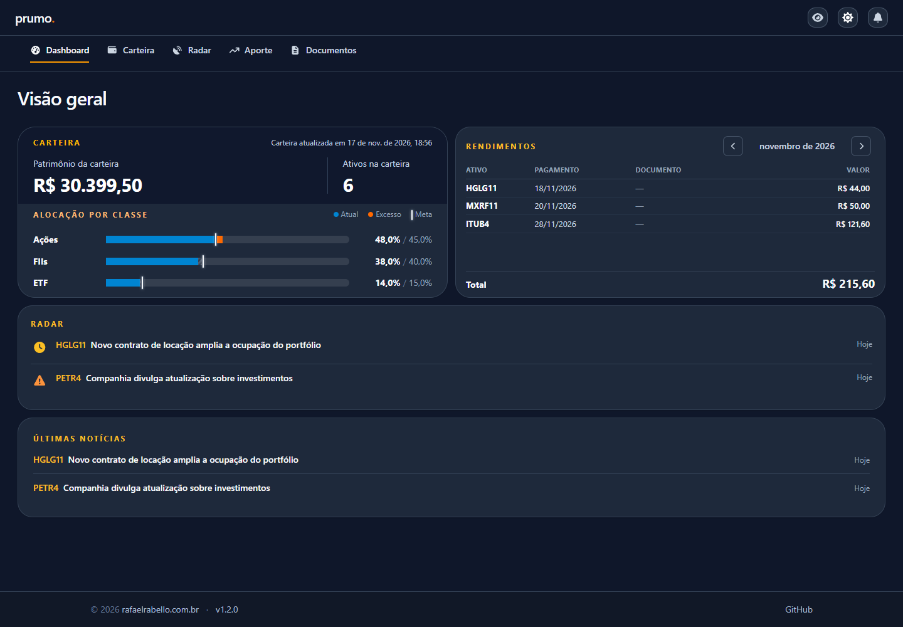
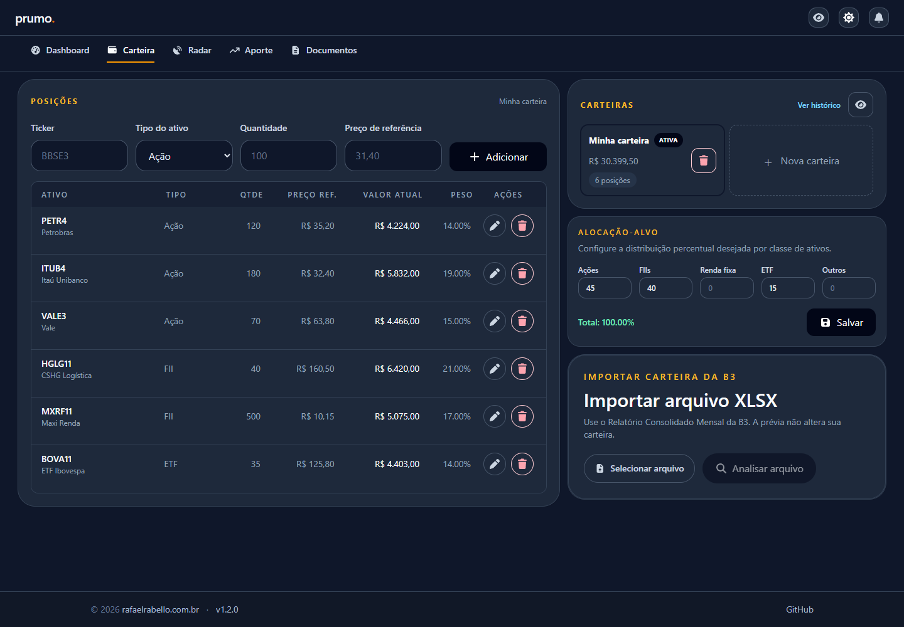

# Prumo

[](https://github.com/rafael89/prumo/actions/workflows/ci.yml)
[](https://github.com/rafael89/prumo/tags)
[](https://docs.docker.com/compose/)

O Prumo é uma aplicação self-hosted para acompanhar sua carteira de investimentos brasileira. Ele reúne posições, documentos da CVM/FNet e análises com IA para ajudar a entender eventos relevantes e planejar novos aportes.

- [Instalação rápida](#instalação-rápida)
- [Configuração](#configuração)
- [Atualização](#atualização)
- [Imagens](#imagens)

## Objetivo

Dar contexto às decisões sobre a carteira sem exigir o acompanhamento manual de cada documento publicado. Importe suas posições, defina as alocações desejadas e use o Radar para revisar o que merece atenção.

## Funcionalidades

- Importação do Relatório Consolidado Mensal da B3 em XLSX, com prévia antes da confirmação.
- Cadastro e acompanhamento de carteiras, posições e alocações-alvo.
- Descoberta e análise de documentos da CVM/FNet, com avaliação do impacto na sua carteira.
- Radar de eventos relevantes, organizado por prioridade.
- Orientação de aportes com cenários de alocação e registro das compras realizadas.
- Histórico de posições, eventos e análises.
- Tema claro e escuro e modo de privacidade para ocultar valores.
- Integração com Gemini, OpenAI e provedores HTTP de IA.

## Imagens

Telas do Prumo com dados fictícios.

<a href="docs/screenshots/dashboard-dark.png"></a>  <a href="docs/screenshots/carteira-dark.png"></a>

## Instalação rápida

Você precisa de [Docker com Compose](https://docs.docker.com/compose/install/).

1. Crie uma pasta para o Prumo e, dentro dela, um arquivo `docker-compose.yml` com este conteúdo:

   ```yaml
   services:
     postgres:
       restart: unless-stopped
       image: postgres:16-alpine
       environment:
         PGDATA: /var/lib/postgresql/data
         POSTGRES_DB: ${POSTGRES_DB:-prumo}
         POSTGRES_USER: ${POSTGRES_USER:-postgres}
         POSTGRES_PASSWORD: ${POSTGRES_PASSWORD:-dev123}
       ports:
         - "127.0.0.1:5432:5432"
       healthcheck:
         test: ["CMD-SHELL", "pg_isready -U $${POSTGRES_USER:-postgres} -d $${POSTGRES_DB:-prumo}"]
         interval: 5s
         timeout: 5s
         retries: 10
       volumes:
         - postgres-data:/var/lib/postgresql

     api:
       restart: unless-stopped
       image: ghcr.io/rafael89/prumo-api:${PRUMO_IMAGE_TAG:-latest}
       environment:
         ASPNETCORE_ENVIRONMENT: Production
         Database__ApplyMigrations: "true"
         ConnectionStrings__Postgres: Host=postgres;Port=5432;Database=${POSTGRES_DB:-prumo};Username=${POSTGRES_USER:-postgres};Password=${POSTGRES_PASSWORD:-dev123}
         Storage__RootPath: /storage/documents
         AI__Provider: ${AI_PROVIDER:-None}
         Discord__WebhookUrl: ${DISCORD_WEBHOOK_URL:-}
       ports:
         - "127.0.0.1:5200:8080"
       healthcheck:
         test: ["CMD", "curl", "--fail", "--silent", "http://localhost:8080/health"]
         interval: 30s
         timeout: 5s
         retries: 3
         start_period: 20s
       volumes:
         - document-storage:/storage/documents
         - api-logs:/storage/logs/api
       depends_on:
         postgres:
           condition: service_healthy

     worker:
       restart: unless-stopped
       image: ghcr.io/rafael89/prumo-worker:${PRUMO_IMAGE_TAG:-latest}
       environment:
         DOTNET_ENVIRONMENT: Production
         ConnectionStrings__Postgres: Host=postgres;Port=5432;Database=${POSTGRES_DB:-prumo};Username=${POSTGRES_USER:-postgres};Password=${POSTGRES_PASSWORD:-dev123}
         Storage__RootPath: /storage/documents
         AI__Provider: ${AI_PROVIDER:-None}
         AI__ApiKey: ${AI_API_KEY:-${GEMINI_API_KEY:-}}
         AI__Endpoint: ${AI_ENDPOINT:-}
         AI__Model: ${AI_MODEL:-gemini-3.5-flash-lite}
         AI__FallbackModel: ${AI_FALLBACK_MODEL:-gemini-3.1-flash-lite}
         Discord__WebhookUrl: ${DISCORD_WEBHOOK_URL:-}
       volumes:
         - document-storage:/storage/documents
         - worker-logs:/storage/logs/worker
       depends_on:
         api:
           condition: service_healthy

     frontend:
       restart: unless-stopped
       image: ghcr.io/rafael89/prumo-frontend:${PRUMO_IMAGE_TAG:-latest}
       ports:
         - "5273:80"
       depends_on:
         - api

   volumes:
     postgres-data:
     document-storage:
     api-logs:
     worker-logs:
   ```

   Na mesma pasta, crie um arquivo `.env` usando o [.env.example](.env.example) como referência.

2. Edite o `.env` e altere `POSTGRES_PASSWORD`. A configuração de IA é opcional.

3. Baixe as imagens e inicie os serviços:

   ```sh
   docker compose up -d
   ```

4. Acesse [http://localhost:5273](http://localhost:5273), crie uma carteira e importe suas posições ou cadastre os ativos manualmente.

O Compose inicia o frontend, a API, o worker e o PostgreSQL. As migrações do banco são aplicadas automaticamente. Dados e documentos ficam em volumes Docker.

## Configuração

As opções mais comuns estão no [.env.example](.env.example):

| Variável | Uso |
| --- | --- |
| `POSTGRES_PASSWORD` | Senha do banco de dados. Altere antes de iniciar. |
| `AI_PROVIDER` | `None` (padrão), `Gemini`, `OpenAI` ou `Http`. |
| `AI_API_KEY` | Chave do provedor. `GEMINI_API_KEY` também é aceita como alternativa. |
| `AI_MODEL` | Modelo usado nas análises. |
| `AI_FALLBACK_MODEL` | Modelo alternativo, quando aplicável ao provedor. |
| `AI_ENDPOINT` | URL HTTP(S) do provedor `Http`. |
| `DISCORD_WEBHOOK_URL` | Webhook opcional para notificações de logs. |

Ao trocar de provedor, ajuste também os modelos. O provedor `Http` exige `AI__Endpoint` no ambiente do worker. A integração OpenAI atende à análise documental; nesse caso, a orientação de aportes usa o motor de regras.

Gemini é o único provedor validado em uso até o momento. OpenAI e HTTP possuem suporte implementado, mas ainda não foram testados em uso.

O Prumo foi pensado para uso pessoal em rede privada e ainda não possui autenticação de usuários. Para acesso remoto, proteja o frontend com VPN ou um proxy com autenticação e HTTPS. Não exponha o banco nem a API diretamente à internet.

## Atualização

Baixe as imagens mais recentes e recrie os serviços:

```sh
docker compose pull
docker compose up -d
```

O Compose recria os serviços quando necessário e mantém os volumes. As migrações são aplicadas automaticamente na inicialização da API. Faça backup dos dados antes de atualizar.

Por padrão, o Compose usa a tag `latest`. Para fixar uma versão específica, adicione `PRUMO_IMAGE_TAG=<sha-do-commit>` ao `.env`, usando uma tag publicada nos três pacotes ([API](https://github.com/rafael89/prumo/pkgs/container/prumo-api), [worker](https://github.com/rafael89/prumo/pkgs/container/prumo-worker) e [frontend](https://github.com/rafael89/prumo/pkgs/container/prumo-frontend)).
